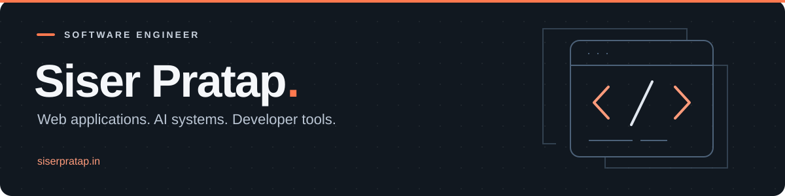

  

<h1 align="center">Hi, I'm Siser Pratap</h1>

  <strong>Software Development Engineer · Full stack development · Applied AI</strong> 
  Gurugram, India

  <a href="https://siserpratap.in">Portfolio</a> ·
  <a href="https://www.linkedin.com/in/siser">LinkedIn</a> ·
  <a href="mailto:siserinsevoc@gmail.com">Email</a> ·
  <a href="https://drive.google.com/file/d/1BaLEqSKQdJxYWMMQYy3_d3TF2p7CxuP5/view">Resume</a>

---

I build web applications, AI workflows, and tools that make everyday work easier. My work spans React and Next.js interfaces, Node.js and Python services, and LLM integrations. I'm especially interested in how these pieces fit together into a usable product.

I'm a **Software Development Engineer at M37 Labs**, working on full stack applications and generative AI systems. Outside work, my projects explore browser-based data analysis, local AI on macOS, authentication, and automation.

**Explore:** [Projects](#selected-projects) · [Skills](#technical-skills) · [Experience](#experience) · [Contributions](#open-source-and-contributions) · [Education](#education) · [Connect](#lets-connect)

## Selected projects

### 01 / In-Browser Data Workbench
**A data analysis workspace with SQL, charts, and AI assistance.** 
I'm developing a workbench with DuckDB-WASM running in a Web Worker, a SQL editor, paged and virtualized results, and charting. Its Python backend includes AI tool calls, SQL validation, and a separate server query engine with resource limits.

**Stack:** TypeScript · Next.js · DuckDB · Apache Arrow · Python · FastAPI 
[Explore the code](https://github.com/Siser-Pratap/In-Browser-Data-Workbench-) · [API architecture](https://github.com/Siser-Pratap/In-Browser-Data-Workbench-/blob/main/apps/api/README.md) 
In development.

### 02 / Mac On-Screen Chat
**A native macOS assistant, one hotkey away.** 
A floating chat panel with reusable prompt skills, streaming responses from local Ollama models, optional Gemini integration, and SQLite persistence for conversations and rules. This project takes my AI work beyond the browser into native desktop interaction.

**Stack:** Swift · SwiftUI · AppKit · Ollama · SQLite / GRDB 
[Explore the code](https://github.com/Siser-Pratap/mac-on-screen-chat)

### 03 / IntelAI
**A conversational AI application with text and image interactions.** 
A Next.js chat interface connected to Gemini, with image uploads and conversation history. The companion Express backend handles user accounts, JWT authentication, and MongoDB persistence.

**Stack:** Next.js · TypeScript · Node.js · Express · MongoDB · Gemini · GSAP 
[Frontend](https://github.com/Siser-Pratap/intelai) · [Backend](https://github.com/Siser-Pratap/IntelAi-Backend) · [Visit the app](https://intelai-siser-pratap.vercel.app/)

### 04 / AI Email Automation
**An application for managing outreach drafts and follow-ups.** 
Combines AI-assisted email drafting with templates, scheduled entries, resume records, and delivery logs. The implementation uses Groq for generation, Prisma with MongoDB for records, and Nodemailer for delivery.

**Stack:** Next.js · TypeScript · AI SDK · Groq · Prisma · MongoDB · Nodemailer 
[Explore the code](https://github.com/Siser-Pratap/AI-Email-Automation)

### 05 / Personal Portfolio
**My portfolio, with scheduling and a chat assistant.** 
Alongside animated project pages, it includes Google Calendar booking, Redis-backed slot reservations, contact and chat endpoints, and regression tests for API and booking behavior.

**Stack:** Next.js · TypeScript · Three.js · GSAP · Redis · Google Calendar API 
[Visit my portfolio](https://siserpratap.in) · [Explore the code](https://github.com/Siser-Pratap/portfolio)

<strong>More projects and experiments</strong>

 

| Project | Focus |
| --- | --- |
| [VisionWeave](https://github.com/Siser-Pratap/VisionWeave) | Prompt-to-image generation using Segmind, with a React interface and an Express/MongoDB sharing backend |
| [Authence](https://github.com/Siser-Pratap/Authence) · [npm package](https://www.npmjs.com/package/authence) | Authentication package experiments with Node.js, Mongoose, and bcrypt |
| [Authence frontend](https://github.com/Siser-Pratap/authence-frontend) | React and TypeScript documentation and dashboard UI |
| [3D portfolio](https://github.com/Siser-Pratap/portfolio-3d) | React Three Fiber scenes, animation, and interactive presentation |
| [MeetPro](https://github.com/Siser-Pratap/meetPro) | Video conferencing project |
| [Intelli-Task](https://github.com/Siser-Pratap/Intelli-Task) | Task management dashboards and analytics interfaces |
| [GSAP + Three.js cylinder](https://github.com/Siser-Pratap/GSAP-THREE-CYLINDER-ANIMATION) | Motion and 3D interaction experiments |

[Browse all my repositories →](https://github.com/Siser-Pratap?tab=repositories)

## Technical skills

| Area | Technologies |
| --- | --- |
| Languages | JavaScript, TypeScript, Python, Java, C++, SQL, Swift, HTML, CSS |
| Frontend | React, Next.js, Tailwind CSS, GSAP, Three.js, React Three Fiber |
| Backend and APIs | Node.js, Express, Nest.js, FastAPI, Django, REST APIs |
| AI applications | LLM integrations, prompt engineering, generative AI, AI SDK, Gemini, Groq, Ollama |
| Data and storage | MongoDB, MySQL, SQLite, Redis, Prisma, DuckDB, Apache Arrow |
| Cloud and tooling | AWS, Docker, Kubernetes, Git, GitHub, npm |

<strong>ML foundations, engineering concepts, and native development</strong>

 

- **ML frameworks:** TensorFlow, PyTorch, Scikit-learn.
- **Foundations:** data structures and algorithms, neural networks, NLP, computer vision.
- **Engineering:** system design, microservices, authentication, CI/CD, API integration, and testing.
- **Native macOS:** SwiftUI, AppKit, Swift Package Manager, and GRDB.
- **Browser data tools:** Web Workers, DuckDB-WASM, SQL editing, and virtualized results.

## Experience

**Software Development Engineer · M37 Labs** 
January 2026 – Present · Gurugram, India · On-site

- Develop full stack applications using the MERN stack, FastAPI, and Django.
- Build generative AI applications using LLMs, prompt engineering, and computer vision.
- Work on inference pipelines, model fine-tuning, human feedback, and backend integration.

**SDE Intern · M37 Labs** 
September 2025 – December 2025 · Gurugram, India · On-site

- Worked on LLM and vision systems, structured prompts, and evaluation frameworks.
- Integrated AI microservices with FastAPI and contributed to AWS deployments, CI/CD, and documentation.

**SDE Intern · Synapsis Medical Technologies** 
February 2025 – April 2025 · Edmonton, Canada · Remote

- Built Nest.js APIs for authentication, appointment tracking, and application modules.
- Developed testing workflows and integrated medical simulation visuals using Three.js, React Three Fiber, and GSAP.

## Open source and contributions

I contribute through code, fixes, and documentation, and maintain my own projects in public.

- **Community contribution:** [coffeeShop #234](https://github.com/Mujtabaa07/coffeeShop/pull/234) — merged changes to the home-page scroll indicator, coffee graphic placement, and spacing.
- **Reliability in my projects:** [portfolio #23](https://github.com/Siser-Pratap/portfolio/pull/23) — merged Redis-backed booking reservations to prevent overlapping requests.
- **Documentation:** [portfolio #18](https://github.com/Siser-Pratap/portfolio/pull/18) — merged corrections to Next.js deployment instructions.
- **Package publishing:** [Authence on npm](https://www.npmjs.com/package/authence) — an authentication package published under my developer account.

[Browse my merged pull requests](https://github.com/search?q=author%3ASiser-Pratap+is%3Apr+is%3Amerged&type=pullrequests) · [Explore my contribution activity](https://github.com/Siser-Pratap?tab=overview)

## Education

**Bachelor of Technology in Information Technology** 
KIET Group of Institutions · Delhi-NCR, India 
October 2022 – Present · **CGPA: 8.1 / 10**

## Beyond the code

- Solved **500+ data structures and algorithms problems**, primarily using C++.
- Delivered **two freelance projects** involving website development and SEO.
- I enjoy exploring the intersection of AI, useful tools, and interactive interfaces.

[LeetCode](https://leetcode.com/siser_ins17/) · [More about my work](https://siserpratap.in)

## Let's connect

For engineering opportunities, technical discussions, or open-source collaboration:

**[Email](mailto:siserinsevoc@gmail.com)** · **[LinkedIn](https://www.linkedin.com/in/siser)** · **[Portfolio](https://siserpratap.in)** · **[Resume](https://drive.google.com/file/d/1BaLEqSKQdJxYWMMQYy3_d3TF2p7CxuP5/view)**

Elsewhere

 

[X / Twitter](https://x.com/PratapSiser) · [Instagram](https://www.instagram.com/siser_ins17)

